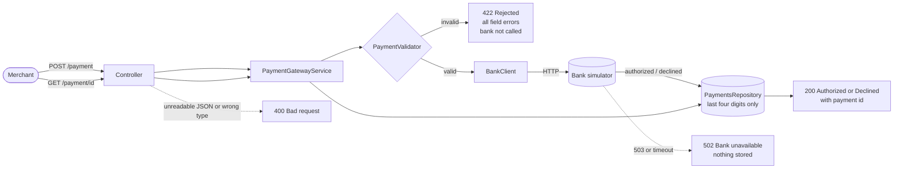

# Design considerations and assumptions

## Overview

A small payment gateway: a merchant submits a card payment, the gateway validates it, asks the
acquiring bank (simulator), stores the outcome and returns it. A merchant can fetch a payment by id.

| Endpoint | Result |
| --- | --- |
| `POST /payment` | `200` Authorized or Declined, `422` Rejected, `400` malformed JSON or wrong type, `502` bank unavailable |
| `GET /payment/{id}` | `200` payment, `404` unknown id, `400` id is not a UUID |

### Request flow

Solid arrows are the normal path, dotted arrows are failures.

Flow of `POST /payment`: validate (collect every error) -> call bank -> map the bank answer to
Authorized or Declined -> store (last four digits only) -> respond.

Layers: `controller` (HTTP), `service` (flow), `validation`, `bank` (client behind an interface so
tests use a fake), `repository` (in-memory), `exception` (mapped to HTTP in one place).

## Key design decisions

| Decision | Why |
| --- | --- |
| Invalid content returns **422** with **all** errors at once; unreadable JSON or wrong types return **400** | The merchant can fix everything in one round trip. 400 means "cannot read your request", 422 means "readable, but the content is not acceptable" |
| A Rejected request is **not stored** and **never reaches the bank** | The brief says no payment is created. Covered by tests (bank called 0 times) |
| Bank `503`, timeout, connection error or empty reply returns **502** and nothing is stored | The bank gave no answer, so reporting Declined would be wrong. See "Not done" for the retry risk |
| Declined by the bank is `200` | The request was processed correctly. Declined is a business result, not an error |
| Full card number and CVV are **never stored, logged or returned**. Only the last four digits are kept | PCI risk. `toString()` of request records is redacted, error messages describe the rule and never quote the submitted value, and the 400 message is fixed text because Jackson's own message can quote the value |
| `cardNumber` and `cvv` are Strings, `amount` is a `long` in minor units | Leading zeros must survive, and 16 to 19 digits overflow an `int` |
| `amount` is read as a number, then must be a whole number: `10.5` returns 422 with field `amount`. A JSON string such as `"100"` returns 400 | By default Jackson would silently turn `10.5` into `10`, which changes the money amount. Rejecting it with a field error is clearer for the merchant |
| Hand-written validator, no extra dependency | Easy to read, one place for every rule, and it can collect all errors and take an injected `Clock` |
| Java records for request and response models | Immutable, no boilerplate, supported by Jackson |
| Bank client behind the `BankClient` interface | The service is tested with a fake bank. The client is tested with `MockRestServiceServer` |
| `PaymentsRepository` uses a `ConcurrentHashMap` | Several requests can write at the same time |

## Assumptions

- **Currency**: any valid ISO 4217 code is accepted, using the JDK's list (upper case only). The
  brief says to validate against "no more than 3 currency codes". I read this as "must be a valid
  ISO code". If the intent is to restrict to three, it is a small allow-list change in
  `PaymentValidator`. Note that the ISO list also contains special codes such as `XXX` and `XAU`.
- **Amount** must be greater than 0 (the brief does not say, but a zero payment has no meaning).
  Amounts are passed through in minor units. No per-currency decimal handling.
- **Expiry**: a card is valid until the end of its expiry month, so the current month is accepted.
  The year must be four digits. The "in the future" check needs a valid month and year, so it is
  reported once the month is fixed.
- **No Luhn check**: the brief does not ask for it, and the simulator's test cards are chosen by the
  last digit, not by checksum.
- **Storage** is the provided in-memory repository, standing in for a database. Data is lost on
  restart.
- JSON uses camelCase, matching the sample code. The bank simulator uses its own snake_case, which is
  handled in `BankRequest` and `BankResponse`.

## Not done on purpose (kept simple, as the brief asks)

| Missing | What I would do in production |
| --- | --- |
| **Idempotency**. A retry creates a second payment (a test documents this) | `Idempotency-Key` header, stored with a unique constraint so concurrent retries create one payment |
| **Bank timeout leaves the result unknown**. The gateway returns 502 and keeps nothing, so the merchant cannot tell whether the bank charged the card | Save the payment as `PENDING` before calling the bank, query the bank by payment id on timeout, and notify the merchant by webhook |
| In-memory storage | Database with an index on the payment id, and a unique key for idempotency |
| Authentication, per-merchant access, rate limiting, TLS | See "Security considerations and known gaps" below |
| Retries, circuit breaker, tracing, alerts | Retry only safe calls, circuit breaker per bank, distributed tracing (OpenTelemetry), alert on bank error rate and latency |
| Currency-specific minor units (JPY has none) | Currency table with exponent |

## Observability

- **Request id**: every request gets an `X-Request-Id`, returned in the response and printed on every
  log line (`[requestId=...]`). A caller's id is reused only if it is safe (letters, digits, `-`,
  max 64), otherwise a new UUID is generated, so nobody can inject text into the logs.
- **Health**: `/actuator/health`, with liveness and readiness probes for the orchestrator.
- **Metrics**: `/actuator/metrics` has the standard HTTP metrics (rate, errors, latency) and a business
  counter `payments.processed` tagged by outcome: `authorized`, `declined`, `rejected`, `bank_unavailable`.
- **Logs never contain card data**: a rejected request logs only the names of the invalid fields.
- **Not done**: distributed tracing, a metrics backend (Prometheus) and alerts. In production I would alert
  on the `bank_unavailable` rate and on p99 latency.

## Packaging and hosting

- `./gradlew bootJar` builds one executable jar.
- The `Dockerfile` is multi-stage: build with the JDK, run on a JRE image as a non-root user.
- `docker-compose up --build` starts the gateway and the bank simulator together. The bank URL is set
  with the `BANK_URL` environment variable, so the same image runs in any environment.
- Graceful shutdown is on, so in-flight requests finish before the pod stops.
- The in-memory store makes the service stateful. Before running more than one instance, the
  repository must move to a database.

## Security considerations and known gaps

**What the service already does**
- The full card number and CVV are never stored, logged or returned. Only the last four digits are kept.
  The full number only exists in memory during a request and in the call to the bank.
- `toString()` of the request is redacted, error messages never repeat the submitted values, and
  the 400 message is fixed text.
- All input is validated before the bank is called, and the service uses no SQL.

**What is not done, because the brief did not ask for it, and how I would fix it**

| Gap | Risk | Fix |
| --- | --- | --- |
| **Authentication** | Anyone who can reach the API can create payments | One API key per merchant in the `Authorization` header. A filter checks it before the controller. Only a hash of the key is stored, and keys can be rotated (two active keys at once) and revoked |
| **Authorization (IDOR)** | Any caller who knows a payment id can read it. A random UUID is not access control | Store the merchant id with each payment and query by payment id **and** merchant id. Return 404 for other merchants' payments. On `POST`, take the merchant id from the authenticated key, never from the request body |
| **Idempotency and replay** | A retry creates a second payment | `Idempotency-Key` header with a unique constraint, so the same key returns the first result |
| **Transport security** | The app speaks plain HTTP | Terminate TLS at the load balancer or API gateway, and use TLS to the bank |
| **Rate limiting and abuse** | A stolen key or a bot can flood the API or test stolen cards | Rate limit per merchant, alert on many declines, limit the request size |
| **Stolen API keys** | A leaked key can create payments | HTTPS only, never log keys, scopes, IP allow-list, per-key limits, expiry, usage monitoring, instant revoke. For stronger security, request signing (HMAC) so the secret is never sent |
| **Card data at rest** | A database leak would expose card data (PCI scope) | Keep only the last four digits. If full numbers are ever needed, use a separate PCI-compliant vault and give the gateway a token |
| **Secrets** | The bank URL is in `application.properties`, and later there will be credentials | Load secrets from a secret manager or environment variables, never from Git |
| **Logging and monitoring** | Every log line has a request id and logs hold no card data, but nothing checks this automatically, and there are no alerts or audit log | A test that fails if a card number appears in logs, alerts on bank error rate and decline rate, an audit log of who did what |
| **Swagger UI** | It shows the API to everyone | Disable it in production or keep it on the internal network |
| **Dependencies** | A library with a known vulnerability | Dependency scan in CI |

The order I would fix them in: authentication and per-merchant access first, then idempotency, then
rate limiting and monitoring.

## Testing

83 automated tests (`./gradlew test`):

- **Validator**: every rule, boundaries (length 14 and 19, previous, current and next month),
  all errors at once, error text never contains submitted values. The clock is fixed.
- **Bank client**: Authorized, Declined, 503, 400, connection failure, empty body, request field
  names and `MM/YYYY` format.
- **Service**: Authorized and Declined are mapped and stored, an invalid request means 0 bank calls
  and nothing stored, a bank failure stores nothing, only the last four digits are kept.
- **Controller** (full Spring context, bank mocked): every status code above, strict number
  handling, no card number in any response, a POST followed by a GET.

I also ran the app against the real bank simulator and checked the three card outcomes (odd, even,
ending in 0) and the application log for leaked card data.

## How to run

Everything in containers (gateway on :8090, bank simulator on :8080):

```bash
docker-compose up --build
```

Or run the gateway locally:

```bash
docker-compose up -d bank_simulator
./gradlew test
./gradlew bootRun        # gateway on :8090, Swagger UI at /swagger-ui/index.html
```

Requires Docker, and JDK 17 for the local option. The bank URL is `bank.url` in
`application.properties` (override with the `BANK_URL` environment variable).

**Try it:** open http://localhost:8090/swagger-ui/index.html, expand `POST /payment` and pick an
example from the "Examples" drop-down: Authorized, Declined, several invalid fields, missing fields,
expired card, amount not a whole number, malformed JSON, bank unavailable. Then copy the returned `id`
into `GET /payment/{id}`.

**Check the service:** `curl http://localhost:8090/actuator/health` and
`curl http://localhost:8090/actuator/metrics/payments.processed`.

**Run the tests:** `./gradlew test` (83 tests, no Docker needed, the bank is mocked).
